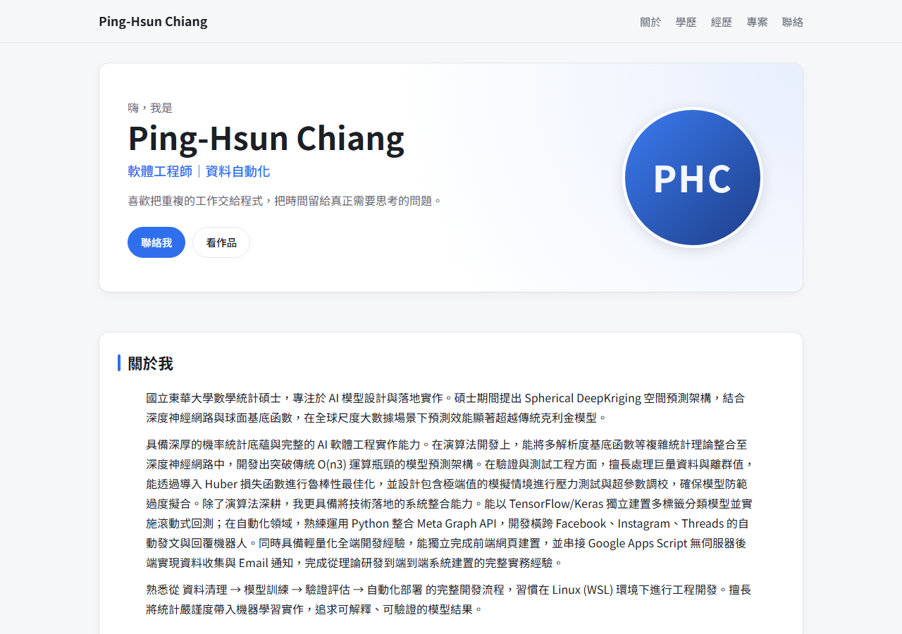
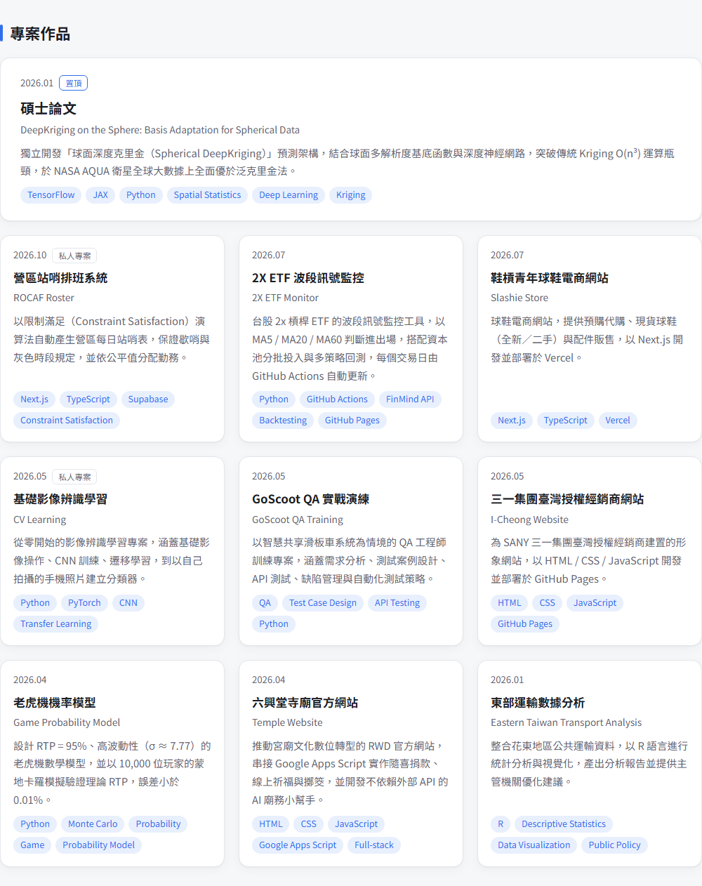
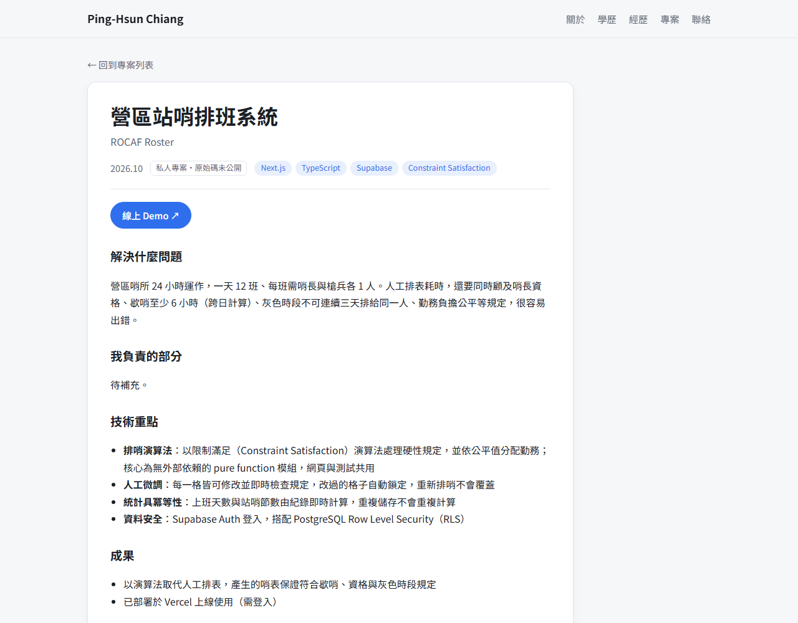

# Andrew Website — 個人履歷與作品集網站

Ping-Hsun Chiang 的個人履歷網站：簡介、學歷、經歷、技能、聯絡方式與專案作品集。
所有內容都和版面分開：文字集中在一個設定檔，每個專案一個 Markdown 檔，
新增作品只要複製範本、填好內容、push，網站就會自動建置上線。

**線上版：** [ping-hsun-chiang.github.io/hsun-website](https://ping-hsun-chiang.github.io/hsun-website/)




---

## 要解決的問題

履歷和作品集需要經常更新，但每次改內容都去翻 HTML 很容易改壞版面；作品一多，每個專案的介紹格式也會越寫越不一致。
這個網站的目標是：

- **內容和版面分開：** 更新履歷只需要改資料，不用碰任何版面程式碼。
- **專案介紹格式一致：** 每個專案都回答同樣的四個問題，招募方可以快速比較。
- **格式錯誤不會上線：** 漏寫段落或欄位填錯時，在部署前就擋下來。

## 功能

- **首頁：** 自我介紹、關於我、學歷、聯絡方式、技能、經歷時間軸、專案作品集。
- **專案卡片：** 顯示日期、標題、英文副標、一句話摘要與技術標籤；**置頂**專案以大卡片排在最前面，
  **私人專案**（原始碼未公開）會加上標記。
- **專案詳情頁：** 每個專案一頁，提供 GitHub、線上 Demo、論文等連結，內文固定為四個段落。
- **深色模式：** 跟隨系統設定（`prefers-color-scheme`）。
- **響應式設計：** 手機、平板、桌機都能閱讀。

| 專案作品集 | 專案詳情頁 |
| --- | --- |
|  |  |

## 設計重點

### 內容即資料

| 內容 | 位置 | 說明 |
| --- | --- | --- |
| 姓名、簡介、聯絡方式、技能、經歷、學歷 | [`src/data/site.ts`](src/data/site.ts) | 單一 TypeScript 檔，留空的聯絡方式不會顯示 |
| 專案 | [`src/content/projects/*.md`](src/content/projects/) | 一個專案一個檔案，檔名即網址 |
| 顏色、字型 | [`src/styles/global.css`](src/styles/global.css) | 最上方的 CSS 變數 |

### 兩層檢查：欄位與段落

專案使用 Astro Content Collections，在 **build 階段**做兩層檢查，任何一層不通過，GitHub Actions 就不會部署：

1. **Frontmatter 欄位**（[`src/content.config.ts`](src/content.config.ts)）：以 Zod schema 定義欄位型別，
   例如 `date` 必須是日期、`github`／`demo`／`paper` 必須是合法網址、`featured`／`private` 為布林值。
2. **內文段落**（[`src/utils/project.ts`](src/utils/project.ts)）：內文的 `##` 標題必須**依序**為以下四個，
   錯誤訊息會指出哪個專案、目前寫了哪些標題：

   ```md
   ## 解決什麼問題
   ## 我負責的部分
   ## 技術重點
   ## 成果
   ```

[`_template.md`](src/content/projects/_template.md) 是新增專案的範本；檔名以底線開頭的檔案不會被載入，所以範本本身不會出現在網站上。

### 排序規則

置頂專案優先，其餘依 `date` 由新到舊排列；日期顯示為 `2026.01` 格式。

## 本機開發

**需要：** Node.js 18.20.8、20.3 以上或 22 以上（Astro 5 的需求）。

```bash
npm install
npm run dev       # http://localhost:4321/hsun-website/
npm run build     # 建置並執行上述兩層檢查
```

## 如何修改內容

| 想改什麼 | 修改哪裡 |
| --- | --- |
| 姓名、簡介、聯絡方式、技能、經歷 | `src/data/site.ts` |
| 大頭照 | 放到 `public/`（例如 `public/avatar.jpg`），在 `site.ts` 填 `avatar: '/avatar.jpg'`；留空則顯示姓名縮寫 |
| PDF 履歷 | 放到 `public/resume.pdf`，在 `site.ts` 填 `resumeUrl: '/resume.pdf'`；留空則不顯示按鈕 |
| 新增／修改專案 | `src/content/projects/*.md` |
| 專案封面圖 | 放到 `public/projects/`，在 md 檔填 `cover: /projects/xxx.png` |
| 顏色、字型 | `src/styles/global.css` 最上方的變數 |

### 新增專案

1. 複製 `src/content/projects/_template.md` 並改名，例如 `my-project.md`（檔名會成為網址 `/projects/my-project/`）。
2. 填寫 frontmatter：`title`、`summary`、`date` 為必填；`subtitle`、`tags`、`github`、`demo`、`paper`、`cover`、`featured`、`private` 為選填。
3. 保留四個 `##` 標題，填入內文。
4. 執行 `npm run build` 確認通過，再 push。

## 部署

推送到 `main` 後，[GitHub Actions](.github/workflows/deploy.yml) 以 `withastro/action` 建置，再部署到 GitHub Pages，約 1～2 分鐘生效。

> 若改用其他 repo 名稱，需同步修改 [`astro.config.mjs`](astro.config.mjs) 的 `base`。

## 專案結構

```
src/
  data/site.ts               個人資料：簡介、聯絡方式、技能、經歷、學歷
  content.config.ts          專案 frontmatter 的 Zod schema
  content/projects/          專案 Markdown（_template.md 為範本，不會被載入）
  pages/
    index.astro              首頁
    projects/[id].astro      專案詳情頁（含段落檢查）
  components/
    Header.astro             導覽列
    ProjectCard.astro        專案卡片（置頂、私人標記、封面）
  layouts/Base.astro         共用版型與 meta
  utils/project.ts           排序、日期格式、段落檢查
  styles/global.css          全站樣式與深色模式變數
.github/workflows/deploy.yml GitHub Pages 部署
.gitmessage                  commit 訊息範本
docs/screenshots/            README 使用的截圖
```

## Commit 規範

格式：

```
<type>: <English summary>

<中文補充說明（選填）>
```

- **標題：** 英文、祈使句、小寫開頭、不加句號、50 字元內
- **內文：** 中文補充做了什麼、為什麼，與標題空一行

| type | 用途 | 範例 |
| --- | --- | --- |
| `feat` | 新功能、新區塊、新頁面 | `feat: add dark mode toggle` |
| `fix` | 修正錯誤 | `fix: correct project link on mobile` |
| `content` | 更新履歷內容 | `content: add report automation project` |
| `style` | 外觀、排版、顏色 | `style: increase card spacing` |
| `refactor` | 重構，不影響外觀與功能 | `refactor: extract timeline component` |
| `docs` | 文件 | `docs: update README` |
| `chore` | 設定、套件、雜項 | `chore: upgrade astro to v6` |
| `ci` | 部署流程 | `ci: cache npm dependencies` |

本 repo 已設定 commit 範本（`.gitmessage`）。重新 clone 後，執行以下指令啟用：

```bash
git config commit.template .gitmessage
```

## 未來規劃

- 補上大頭照與 PDF 履歷
- 為專案加上封面圖
- 補齊仍標示「待補充」的專案段落
